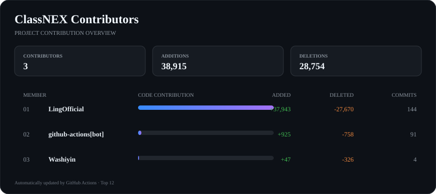

<!--markdownlint-disable MD001 MD033 MD041 MD051-->

<div align="center">

# <image src="1.png" height="28" width="28"/> ClassNEX

ClassNEX 在 Windows 桌面显示课表、倒计时和课堂提醒。客户端可独立使用，也可通过网页集控统一调整多台教室设备。

#### 🌐 官方网站 | 🚀 软件下载 | 📚 项目文档 | 💬 社区交流

</div>

> [!WARNING]
> **ClassNEX 目前仍处于开发阶段。**
>
> 项目仍在快速迭代中，部分功能尚未完成，API、配置格式及项目结构可能发生变化。
> **目前不建议将 ClassNEX 用于生产环境。**
## 贡献者

<p align="center">
  
</p>
---

## Windows 桌面版

上课时，浮窗显示当前课程和剩余时间；课间显示接下来的安排。托盘菜单可以打开课表档案、调整组件或进入设置。CSES YAML 课表和便携版 `data/` 目录沿用 Alpha 格式。

| 模块 | 说明 |
| --- | --- |
| **主界面**（悬浮组件课表） | 无边框半透明置顶卡片，内容由**可自定义的组件**拼装：日期、时钟、今日课表、当前/下节课、倒计时、自定义文本；可拖拽、右键菜单 |
| **应用设置** | 原生 WinUI 3 导航和设置页；可搜索并调整外观、浮窗、组件、提醒、NEX、账户和集控选项。 |
| **档案编辑器** | 课表 / 时间表 / 科目 / 调课 四个标签页；**课表可增删改**（点空格新增、点卡片编辑），**时间表节次可编辑**（改时间会同步到课表） |
| **系统托盘** | 显示/隐藏主界面、编辑档案、加载课表、换课、编辑主界面、应用设置、重启、退出 |

### 配色与动效

应用设置使用 Windows App SDK 的 WinUI 3 控件、Mica 背景和系统主题资源。桌面课表、提醒和助手提示使用同一个浮窗。同一时间只显示一种内容；切换回课表时，按当前内容重新测量窗口。系统关闭动画时，页面直接切换。

### 运行

```powershell
dotnet restore ClassNex.sln
dotnet build src/ClassNex/ClassNex.csproj -c Debug -t:Rebuild
dotnet run --project src/ClassNex/ClassNex.csproj --no-build
```

首次启动先完成向导。之后可从系统托盘打开「应用设置」。关闭鼠标穿透后，也可右键桌面课表打开菜单。开发版运行需要匹配的 Windows App Runtime；win-x64 自包含载荷自带运行时。

### 技术栈（桌面端）

| 组件 | 用途 |
| --- | --- |
| .NET 10、Windows App SDK 1.8 / WinUI 3 | Windows 消息循环、原生设置与页面导航 |
| Avalonia 11.3 / AvaloniaFluentUI | 透明桌面课表与提醒，档案、OOBE、登录与托盘 |
| YamlDotNet | CSES 课表读写 |

### 目录结构（当前）

| `src/` 下的项目 | 职责 |
| --- | --- |
| `ClassNex.Core` | 数据模型、课表、设置、组件和插件接口，不依赖 UI |
| `ClassNex.Notification.Service` | 提醒的时机、顺序和时长 |
| `ClassNex.Plugin` | 插件发现、加载和卸载 |
| `ClassNex.AI` | NEX 会话、模型目录和工具调用 |
| `ClassNex.WinUI` | 原生设置窗口与界面桥接契约 |
| `ClassNex` | 客户端入口、服务组装、平台和辅助窗口 |
| `ClassNex.Central` / `ClassNex.Launcher` | 独立集控服务 / 便携版启动器 |

### 数据存储

| 文件 | 内容 |
| --- | --- |
| `data/Settings.json` | 应用设置（与程序同级，便携） |
| `data/timetable.yaml` | 本机课表；也可在档案编辑器中导入自己的 CSES 文件 |

- **课表与档案**：编辑课程、科目和上课／课间时间点。课表支持每周、单周和双周安排。
- **桌面与通知**：主题支持浅色、深色或跟随系统。浮窗可调整字号、顺序、比例与鼠标穿透；提醒不使用 TTS。
- **账户与集控**：ClassNEX ID 使用浏览器授权。登录集控端后可把设备分配给班级、修改课表与桌面设置。本机身份和接口密钥不随设置上传。
- **扩展**：插件运行在信任的桌面进程内，并非安全沙箱。NEX Intelligence 使用用户配置的接口；软件不携带通用 API 密钥。

模块边界见 [架构说明](docs/ARCHITECTURE.md)，插件开发见 [插件 SDK](docs/PLUGIN_SDK.md)，复测和已知边界见 [本分支交付记录](docs/26.0-acceptance.md)。

### 课表格式（CSES）

```yaml
version: 1
subjects:
  - name: 数学            # 课程名（必填）
    simplified_name: 数   # 简称（可选）
    teacher: 李梅          # 教师（可选）
    room: "101"            # 教室（可选）
schedules:
  - name: 星期一
    enable_day: 1          # 1-7：周一~周日
    weeks: all             # all / odd / even
    classes:
      - subject: 数学
        start_time: "08:00:00"
        end_time: "08:45:00"
```

---

## 获取帮助＆加入社区

您可以通过以下方式获取帮助：

* 项目文档
* GitHub Issues
* GitHub Discussions

如果您确定遇到的是 Bug，或者希望提出新的功能，请提交 Issue。

## 开发

桌面、核心和集控共用 `ClassNex.sln`。桌面窗口使用 Avalonia，集控服务使用 ASP.NET Core。验证本地改动可运行 `dotnet test ClassNex.sln`。

```text
src/
├── ClassNex/                        桌面窗口与平台适配
├── ClassNex.Core/                   业务模型与公共契约
├── ClassNex.Notification.Service/   提醒与投递队列
├── ClassNex.Plugin/                 插件发现与生命周期
├── ClassNex.AI/                     NEX Intelligence
├── ClassNex.Central/                独立集控站点
└── ClassNex.Launcher/               便携版启动器
```

验证脚本在独立目录生成匿名数据，不使用日常账户。模块依赖见 [架构说明](docs/ARCHITECTURE.md)，插件契约见 [插件 SDK](docs/PLUGIN_SDK.md)。

## 致谢

本项目的开发参考了以下优秀的开源项目：

* [FluentUI（AvaloniaFluentUI）](https://github.com/IzumiPL/Avalonia-Fluent-UI)
* [ClassIsland](https://github.com/ClassIsland/ClassIsland)
* [FlClash](https://github.com/chen08209/FlClash)
* [Class-Widgets-2](https://github.com/RinLit-233-shiroko/Class-Widgets-2)
* [MornheIsland](https://github.com/HeyCrab3/MornheIsland)

感谢这些项目在课表软件,集控方案方面提供的参考。

## 许可证

ClassNEX 使用 GNU General Public License v3.0 开源协议。

详见 [LICENSE](LICENSE)。

---
**ClassNEX · Produced by LING & Washiyin**
