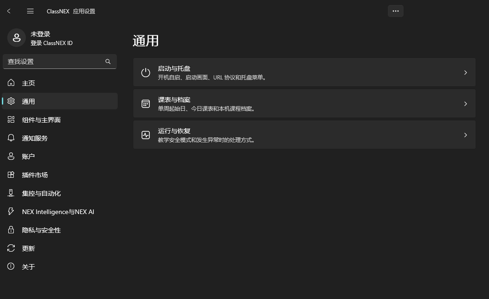
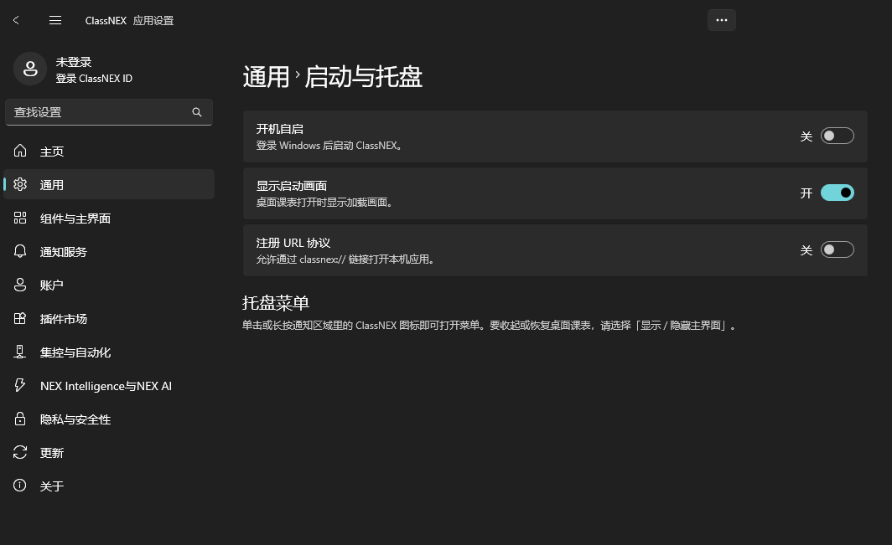

# 26w48a · 客户端设置与托盘

本轮基于主线 `943e47a`，客户端功能提交为 `2952452`。`26w48a` 是客户端产品版本，对应的 GitHub 预发布标签为 `26w48a_Alpha`。





[窄窗中的开关和下拉框](../artifacts/26w48a-settings/runtime-narrow.png)

## 用户可见的变化

- 单击、长按约半秒、右键及键盘激活都打开同一个托盘菜单。旧版默认值 `TrayClickBehavior=0` 原本直接切换浮窗；新版忽略旧动作配置，只有选择「显示 / 隐藏主界面」才会改变可见性。首次向导未完成时的菜单只提供继续设置和退出。
- 通用、组件与主界面、通知、NEX 和隐私共十二个详情入口。整行是一个原生按钮，右侧箭头不是单独的点击目标。子页保留原控件和设置键，面包屑或返回键回到上一级；搜索可直达具体控件。
- 编辑行统一尾端对齐。原生 WinUI `ToggleSwitch` 继续负责键盘、辅助功能、滑动及主题状态；可见的「开 / 关」放在轨道左边。比较的是开关轨道、组合框等实际可见边界，而不是默认包含额外空白的 154 DIP 控件。
- 版本由 `src/DesktopVersion.props` 提供，设置的关于和更新、档案编辑器、助手上下文、集控客户端上报、Windows 客户端与启动器共用。没有更改程序集数字版本或插件 API 兼容范围。

## 本轮实测

- Debug 完整重建、Release 构建均为 0 警告、0 错误。41 项单元测试通过，其中 Core 26 项、通知 9 项、插件 6 项。
- 84 项原生设置交互检查通过，包括十二个详情入口、返回焦点、开关持久化，以及关于、更新和档案编辑器显示相同版本。另在真实窗口手动点击分类行的空白处，切换「教学安全模式」后返回再进入，状态保留。
- 最后一轮实窗回归通过 380 项检查。原生设置在 1080、720、620 DIP 窗宽下检查了宽窄布局、深浅主题。抽测的开关轨道、下拉框和日期控件到卡片右边都是 17 DIP；在 620 DIP 窗宽下通过折叠侧栏搜索具体提醒后，焦点落在对应的开关上。上面的三张 PNG 来自这一轮，未使用设计稿代替。
- 在 100% 显示器上，将原生设置的 XAML 内容区实测调整到 864×720、720×600 DIP，分别对应 1080×900 像素在 125% 和 150% 时的可用空间。两种布局都通过，未把它们算作实体高 DPI 屏的渲染测试。
- 托盘回归通过 91 项：四种旧偏好各 21 项，首次引导 7 项。覆盖按住时打开、松手不重复、拖出再拖回不打开、键盘和右键、Explorer 临时拒绝注册后的恢复，以及只有选中显隐命令才会改变课表可见性。
- 使用本地回环身份服务联测桌面登录、切换与取消、头像归属、集控双向同步设置与课表、重启后会话保留，均通过；未连接生产账号。另已核对客户端 EXE、主 DLL 和便携启动器的 Windows「产品版本」均为 `26w48a`。

## 怎样复测

在 Windows 上执行，`-Round` 每次使用新的名称；不同的实窗验收不要同时抢焦点：

```powershell
dotnet restore ClassNex.sln
dotnet build src/ClassNex/ClassNex.csproj -c Debug -t:Rebuild
dotnet test ClassNex.sln -c Debug --no-restore
./tools/verify_settings.ps1 -ExpectedProductVersion 26w48a -TimeoutSeconds 150
./tools/verify_tray.ps1 -Round my-tray-check
./tools/review_desktop.ps1 -Round my-settings-check -EnabledReminders
dotnet build src/ClassNex.Central/ClassNex.Central.csproj -c Debug
py -3 -B tools/test_central_oauth.py --desktop src/ClassNex/ClassNex.csproj
```

实窗只使用匿名档案。托盘验收向已向 Explorer 注册的本程序窗口投递通知区回调，观察真实菜单、焦点和课表可见性；这不是物理触摸屏按压测试。设置使用 Windows 当前显示比例；等效客户区测试不代替另一台物理高 DPI 显示器。
